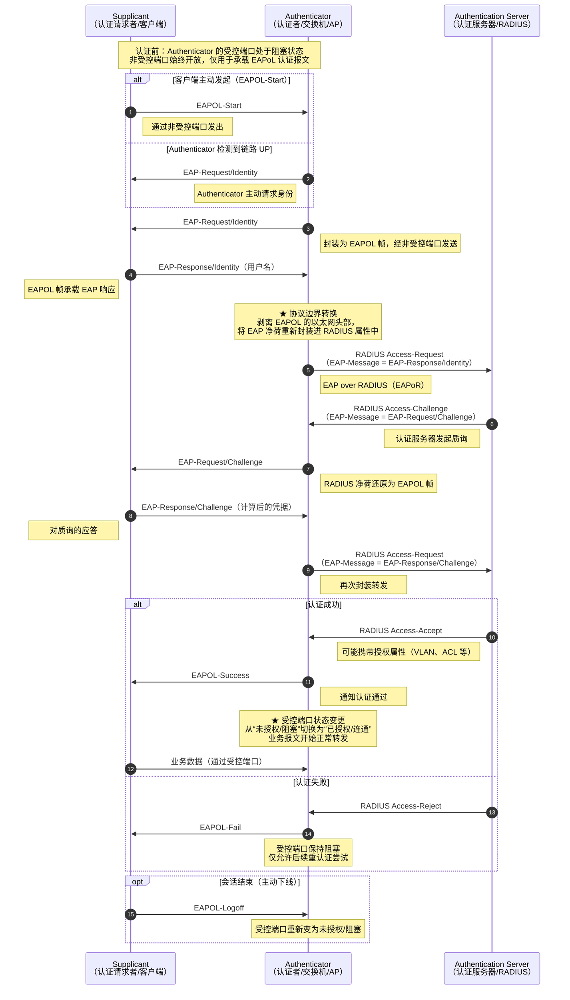

# 802.1x
### Q1：
- 企业为什么要用802.1x，不直接用密码
### A：
- 一人一码，用户分权，验证证书


### Q2：
- 802.1x有几个组件，作用是什么，直接的关系又是什么

### A：
```
┌──────────┐
│  客户端   │
│需要联网终端│
└────┬─────┘
     │ EAPoL
     │ ①提交凭证
     ▼
┌──────────┐
│ 认证设备  │
│交换机/AP  │
└──┬────┬──┘
   │    │
   │    └──▶ 受控端口
   │         未认证：仅放行 EAPoL
   │         认证成功：放行业务流量
   │
   │ RADIUS
   │ ②转发请求
   ▼
┌───────────────────┐
│      认证服务器     │
│       RADIUS      │
│ 验证，授权，计费/审计 │
└────────────────────┘
     │
     └──────▶ 结果回给认证者执行
```
`AAA` 认证
验证： `authentication`
授权： `authorization`
计费： `account`


## EAP框架
EAPOL —— EAP OVER LAN（二层）

## 认证设备
认证服务器
- RADIUS —— 标准
	- udp 1812 ——验证端口
	- udp 1813 ——记账端口
- TACAS ——思科专有
- HACA ——华为专有

