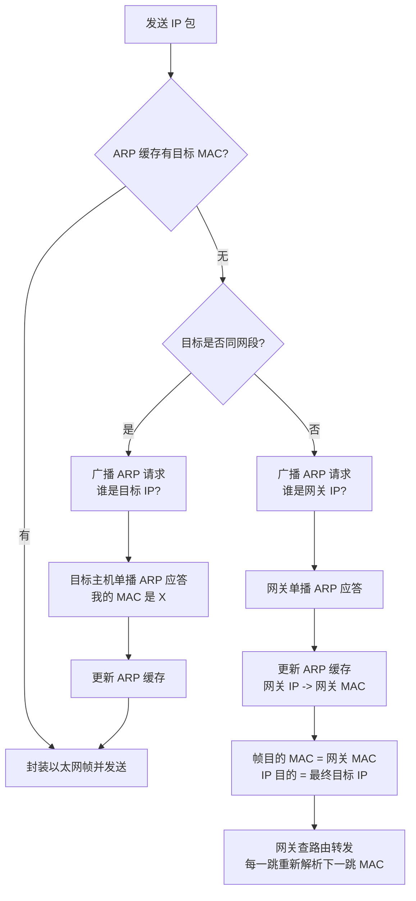
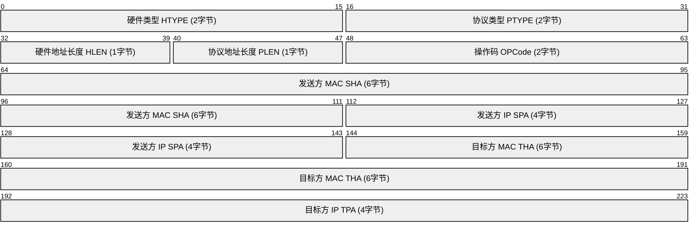
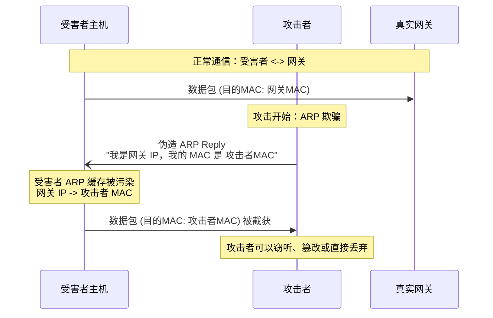
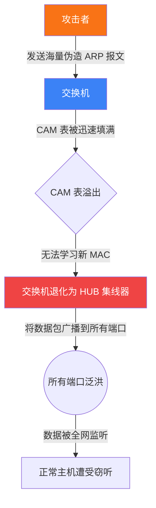

---
tags:
  - 上课
published: 2026-11-04
title: 网络互联安全技术 2026.11.4
category: 网络互联
---
# ARP
## ARP 在 OSI 模型中的位置

ARP 负责连接网络层的 IPv4 地址与数据链路层的 MAC 地址，因此常被称为“二层与三层之间的协议”。

### OSI 七层模型
```
7 · 应用层
6 · 表示层
5 · 会话层
4 · 传输层
3 · 网络层 IPv4：使用 IP 地址进行寻址
- ARP · 地址解析 在 IP 地址与 MAC 地址之间建立映射
2 · 数据链路层 以太网：使用 MAC 地址进行本地帧交付
1 · 物理层
```



## 报文结构
**OPCode**
- **1 = ARP Request（ARP 请求）**：用于询问某个 IP 地址对应的 MAC 地址。
- **2 = ARP Reply（ARP 应答）**：用于回答请求，告知自己的 MAC 地址。


## 字段解释

### 逐字段讲解

| 字段 | 长度 | 含义与常见取值 |
| :--- | :--- | :--- |
| **HTYPE** | 2 字节 | 硬件类型。以太网为 1。 |
| **PTYPE** | 2 字节 | 协议类型。IPv4 为 0x0800。 |
| **HLEN / PLEN** | 各 1 字节 | 硬件地址长度 / 协议地址长度。以太网 MAC 为 6，IPv4 为 4。 |
| **OPER** | 2 字节 | 操作码：1 = Request（请求）；2 = Reply（应答）。 |
| **SHA / SPA** | 6 + 4 字节 | 发送方硬件地址（MAC）与发送方协议地址（IPv4）。 |
| **THA / TPA** | 6 + 4 字节 | 目标方硬件地址（MAC）与目标方协议地址（IPv4）。 |

> 💡 **特别注意**  
> ARP Request 中，目标 MAC（THA）通常填 `00:00:00:00:00:00`，因为请求方正是在询问这个地址；目标 IP（TPA）则是要查询的 IP。


## 1. ARP 欺骗 (Spoofing / Poisoning)

**原理**：攻击者发送伪造的 ARP 报文，将某个 IP（通常是网关）的 MAC 地址映射为攻击者的 MAC 地址，从而“毒化”受害者的 ARP 缓存表。


---
## 2. 中间人攻击 (MITM - Man-in-the-Middle)

**原理**：ARP 欺骗的进阶用法。攻击者同时欺骗通信双方（受害者和网关），将自己置于数据通路的正中间，实现流量透明转发与窃听

> **后果**：所有流经攻击者的流量均可被监听（抓取账号密码）、篡改（插入恶意链接）或阻断。
---
## 3. ARP / MAC 泛洪攻击 (Flooding)

**原理**：攻击者向交换机发送海量伪造源 MAC 的 ARP 报文，迅速填满交换机的 MAC 地址表（CAM 表），导致交换机无法学习正常主机的 MAC 地址。


---
## 4. 拒绝服务攻击 (DoS - Denial of Service)

**原理**：通过 ARP 欺骗，让受害者无法正常上网。

- **断网攻击**：伪造网关 ARP 应答，告诉受害者“网关的 MAC 是 `00:00:00:00:00:00`”。受害者将数据发往一个不存在的 MAC 地址，导致直接断网。
    
- **IP 冲突**：发送免费 ARP (Gratuitous ARP)，声称自己的 IP 就是受害者的 IP，导致受害者不断弹出“IP 地址冲突”警告，网络异常。

---
---

